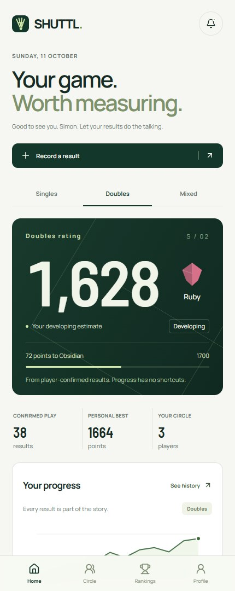
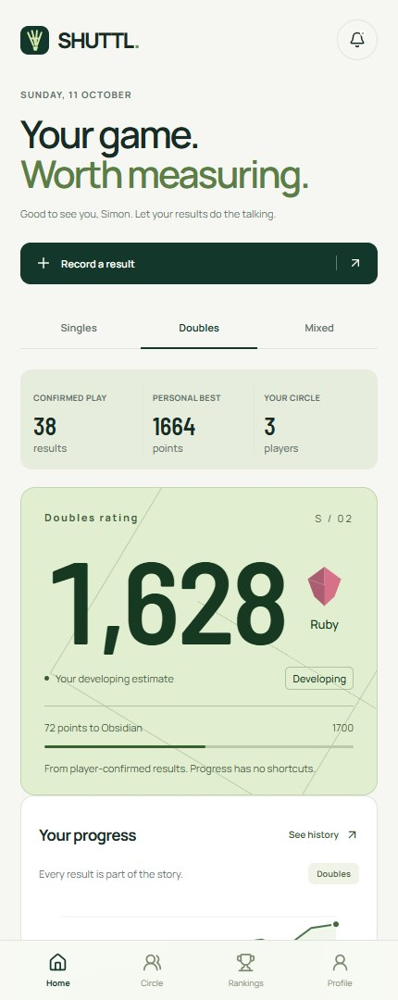
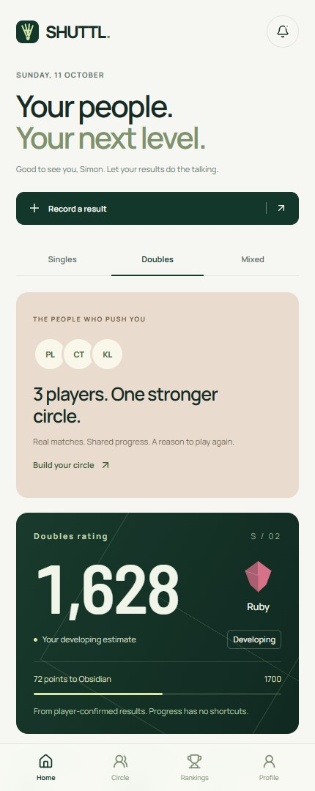
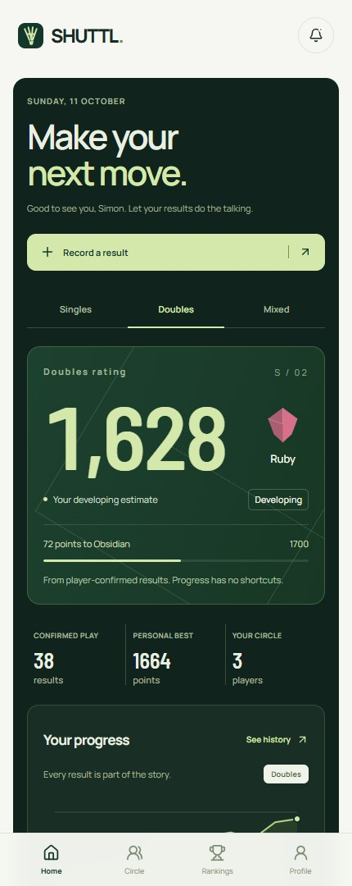
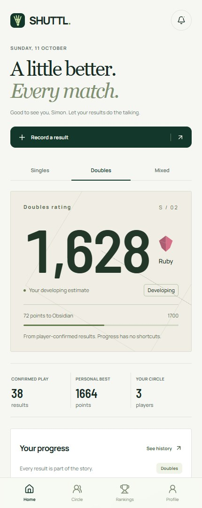

# Five SHUTTL home directions

These captures come from the implemented responsive application. The players, numbers and activity in the design preview are fictional samples. Normal accounts start empty and show actual confirmed evidence.

| Direction        | Layout and feeling                                                                                  |
| ---------------- | --------------------------------------------------------------------------------------------------- |
| Player passport  | A forest-green rating passport leads, followed by progress and social context. The current default. |
| On the court     | A fresh sporting layout puts compact progress facts ahead of the rating passport.                   |
| Circle first     | Social context leads; the player's rating sits within the circle's activity.                        |
| After hours      | A dark arena treatment with a prominent league progression strip.                                   |
| Quiet confidence | Airy editorial composition with a serif heading and restrained surfaces.                            |

## Player passport

## On the court

## Circle first

## After hours

## Quiet confidence

Preview locally at `/design?concept=passport`, `court`, `circle`, `arena` or `editorial`. The preview controls switch categories and directions; Mixed intentionally shows an unrated state rather than invented history.
